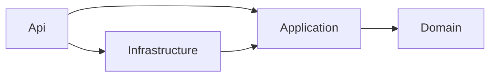

# PrestaFácil

Sistema de gestión de préstamos personales para cajas y financieras pequeñas. Cubre el ciclo completo del crédito: registro del cliente, evaluación de capacidad de pago, aprobación, desembolso, cronograma de cuotas (sistema francés), pagos, mora y reportes.

> 🚧 **En desarrollo.** Terminado: base de datos, clientes, préstamos, pagos, mora, reportes, autenticación JWT y roles. Siguiente: Docker y CI.

## Stack

| Capa | Tecnología |
|---|---|
| Base de datos | SQL Server, procedimientos almacenados |
| Backend | ASP.NET Core Web API (.NET 10), C#, Entity Framework Core, ADO.NET, FluentValidation |
| Seguridad | JWT Bearer, autorización por roles (ADMIN, ASESOR, CAJERO), BCrypt, rate limiting |
| Calidad | xUnit, Swagger/OpenAPI, ProblemDetails · Docker y GitHub Actions *(próximamente)* |
| Frontend | React *(próximamente)* |

## Documentación

- [Requerimientos y reglas de negocio](docs/01_requerimientos.md)
- [Modelo de datos y decisiones de diseño](docs/02_modelo_datos.md)

## Arquitectura

Arquitectura en capas: cada capa solo conoce a la de adentro.

```
src/
├── PrestaFacil.Domain          Entidades y reglas de negocio (sin dependencias)
├── PrestaFacil.Application     Casos de uso, DTOs, validaciones, interfaces
├── PrestaFacil.Infrastructure  EF Core, repositorios, llamadas a procedimientos
└── PrestaFacil.Api             Controladores, manejo de errores, Swagger
tests/
└── PrestaFacil.UnitTests       Pruebas xUnit de dominio y servicios
```



## Endpoints disponibles

| Método | Ruta | Descripción |
|---|---|---|
| GET | `/api/clientes?buscar=&soloActivos=&pagina=&tamanoPagina=` | Búsqueda por DNI o nombre (sin importar tildes) |
| GET | `/api/clientes/{id}` | Detalle del cliente |
| GET | `/api/clientes/dni/{dni}` | Buscar por DNI |
| POST | `/api/clientes` | Registrar cliente |
| PUT | `/api/clientes/{id}` | Actualizar cliente |
| PATCH | `/api/clientes/{id}/desactivar` · `/activar` | Desactivar o reactivar (no se borra) |
| GET | `/api/clientes/{id}/estado-cuenta` | Préstamos, cuotas por pagar y deuda total (`sp_EstadoCuentaCliente`) |
| GET | `/api/productos` | Productos de préstamo con tasas y límites |
| POST | `/api/prestamos/simular` | Cuota y cronograma sin guardar; con `clienteId` incluye la evaluación |
| POST | `/api/prestamos` | Registrar solicitud |
| GET | `/api/prestamos?estado=&clienteId=` | Listar préstamos |
| GET | `/api/prestamos/{id}` | Detalle con historial de estados |
| GET | `/api/prestamos/{id}/evaluacion` | Evaluación crediticia (RN-04 a RN-07) |
| POST | `/api/prestamos/{id}/aprobar` · `/rechazar` | Aprobar (vuelve a evaluar) o rechazar con motivo |
| POST | `/api/prestamos/{id}/desembolsar` | Desembolsar y generar el cronograma |
| GET | `/api/prestamos/{id}/cronograma` | Cronograma con lo pagado y lo pendiente |
| GET | `/api/prestamos/{id}/deuda` | Deuda a hoy: cuotas vencidas, mora, total para ponerse al día y para cancelar |
| GET | `/api/prestamos/{id}/pagos` | Pagos con su distribución por cuota |
| POST | `/api/prestamos/{id}/pagos` | Cobrar: aplica a la cuota más antigua; mora → interés → capital |
| POST | `/api/prestamos/{id}/pagos/{pagoId}/anular` | Anular el último pago y revertir sus abonos |
| GET | `/api/reportes/cartera` | Cartera por estado (`sp_ReporteCartera`) |
| GET | `/api/reportes/morosos?diasMinimos=` | Morosos (`sp_ReporteMorosos`) |
| GET | `/api/reportes/cobranza?desde=&hasta=` | Cobranza por cajero y medio de pago (`sp_ReporteCobranza`) |
| POST | `/api/mora/procesar` | Ejecutar ahora el proceso de mora (también corre solo cada 24 h) |

| POST | `/api/auth/login` | Iniciar sesión: devuelve el token JWT (máx. 5 intentos por minuto) |
| GET | `/api/auth/yo` · POST `/api/auth/cambiar-password` | Usuario actual y cambio de contraseña |
| GET · POST · PUT | `/api/usuarios` | Gestión de usuarios (solo ADMIN): crear, editar, desactivar, restablecer contraseña |

Todos los endpoints, salvo el login, requieren token. Qué rol puede hacer cada operación está en la [matriz de permisos](docs/01_requerimientos.md#21-matriz-de-permisos).

## Seguridad

- **JWT Bearer** firmado con HMAC-SHA256 y válido por 60 minutos. En cada petición se revisa que el usuario siga activo y con el mismo rol, así que desactivar a alguien tiene efecto inmediato.
- **Roles** con `[Authorize(Roles = ...)]` en cada endpoint. Una política global exige sesión en todo lo que no esté marcado como público.
- **Contraseñas** con hash **BCrypt**; política de complejidad con FluentValidation.
- **Login**: máximo 5 intentos por minuto por IP (rate limiting de ASP.NET Core). El mismo mensaje para usuario inexistente o contraseña incorrecta, con el mismo tiempo de respuesta.
- **Segregación de funciones**: quien registra una solicitud no puede aprobarla.
- **Secretos**: la clave JWT de `appsettings.Development.json` sirve **solo para desarrollo**. En producción se pasa por la variable de entorno `Jwt__Key`, y la API no arranca si falta o tiene menos de 32 caracteres.

Los errores siguen el estándar **ProblemDetails**: `400` para datos inválidos (con el detalle por campo), `404` si no existe, `409` para un DNI duplicado o dos cobros simultáneos al mismo préstamo y `422` cuando no se cumple una regla de negocio.

## Crear la base de datos

Requisito: SQL Server (Express funciona). Ejecuta los scripts en orden, ya sea en SSMS o con `sqlcmd`:

```bash
cd database
sqlcmd -S .\SQLEXPRESS -E -i 01_schema.sql
sqlcmd -S .\SQLEXPRESS -E -i 02_procedures.sql
sqlcmd -S .\SQLEXPRESS -E -i 03_seed.sql
```

> ⚠️ `01_schema.sql` borra y vuelve a crear la base `PrestaFacilDB`.

Pruébalo:

```sql
USE PrestaFacilDB;
EXEC sp_ReporteCartera;
EXEC sp_ReporteMorosos;
EXEC sp_EstadoCuentaCliente @ClienteId = 1;
```

## Ejecutar la API

Requisito: .NET 10 SDK. La cadena de conexión está en `src/PrestaFacil.Api/appsettings.Development.json` (usa `.\SQLEXPRESS` con autenticación de Windows).

```bash
dotnet run --project src/PrestaFacil.Api --launch-profile http
```

Abre http://localhost:5039/swagger. En Visual Studio, abre `PrestaFacil.slnx` y presiona F5.

**Iniciar sesión en Swagger:**
1. En `POST /api/auth/login` usa uno de los usuarios de prueba (`admin`, `asesor1`, `asesor2`, `cajero1`). La contraseña de desarrollo está en `Demo:PasswordInicial` de `appsettings.Development.json`: al iniciar, la API se la asigna a los usuarios creados por `03_seed.sql`.
2. Copia el `token` de la respuesta.
3. Pulsa **Authorize** (arriba a la derecha), pégalo y confirma. Swagger lo recuerda aunque recargues la página.

## Pruebas

```bash
dotnet test
```

## Hoja de ruta

- [x] Requerimientos y reglas de negocio
- [x] Modelo de datos, procedimientos almacenados y datos de prueba
- [x] API base en capas y módulo de clientes
- [x] Préstamos: simulador, evaluación, aprobación, desembolso y cronograma
- [x] Pagos, mora (proceso diario en segundo plano), anulaciones y reportes
- [x] Autenticación JWT, roles, gestión de usuarios y límite de intentos de login
- [ ] Docker y CI (las pruebas unitarias se agregan en cada módulo)
- [ ] Frontend en React y despliegue

## Autora

**Jhamile Macavilca** — Estudiante de Diseño y Desarrollo de Software, Tecsup
[GitHub](https://github.com/jhamile4) · [LinkedIn](https://www.linkedin.com/in/jhamile-jhersy-macavilca-nolasco-239800361/)
