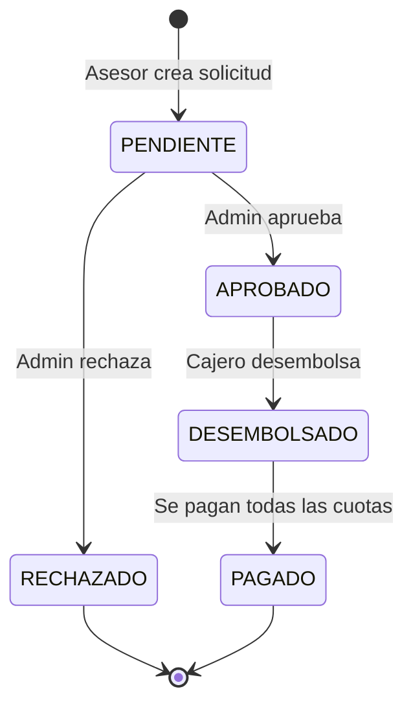

# PrestaFácil — Documento de Requerimientos

**Autora:** Jhamile Macavilca
**Versión:** 1.0 — octubre 2026

---

## 1. Contexto del negocio

Una caja o financiera pequeña otorga **préstamos personales en soles** a trabajadores y emprendedores. Hoy lleva el control en hojas de Excel, lo que genera tres problemas:

1. **Errores en el cálculo de cuotas e intereses.** Cada asesor calcula a mano y los cronogramas no coinciden.
2. **No se sabe a tiempo quién está en mora.** La cobranza se entera tarde de los atrasos.
3. **No hay control de quién hizo qué.** Cualquiera puede aprobar un préstamo o registrar un pago.

**PrestaFácil** centraliza el ciclo completo del préstamo: registro del cliente → solicitud → evaluación → aprobación → desembolso → cronograma → pagos → mora → reportes.

### Objetivos medibles
| Objetivo | Indicador |
|---|---|
| Eliminar errores de cálculo | 100 % de cronogramas generados por el sistema |
| Detectar la mora a tiempo | Reporte de morosos disponible al día |
| Trazabilidad | Todo cambio de estado y pago queda registrado con usuario y fecha |

---

## 2. Actores y roles

| Rol | Quién es | Qué puede hacer |
|---|---|---|
| **ADMIN** | Jefe de agencia | Todo: gestionar usuarios, productos de préstamo, aprobar y rechazar, ver reportes |
| **ASESOR** | Asesor de créditos | Registrar clientes, crear solicitudes, evaluarlas, ver el estado de cuenta |
| **CAJERO** | Personal de caja | Desembolsar préstamos aprobados y registrar pagos |

> Un asesor **no puede aprobar** sus propias solicitudes: la aprobación es del ADMIN (segregación de funciones).

---

## 3. Requerimientos funcionales

### Módulo 1 — Clientes
| ID | Requerimiento |
|---|---|
| RF-01 | Registrar un cliente con DNI, nombres, apellidos, fecha de nacimiento, teléfono, correo, dirección, ingreso mensual y gastos mensuales. |
| RF-02 | Buscar clientes por DNI o por nombre. |
| RF-03 | Editar los datos del cliente y desactivarlo (no se elimina físicamente). |
| RF-04 | Ver el estado de cuenta del cliente: sus préstamos, cuotas pendientes y deuda total. |

### Módulo 2 — Productos de préstamo
| ID | Requerimiento |
|---|---|
| RF-05 | El ADMIN configura productos (ej. "Préstamo Personal", "Préstamo Emprendedor") con su TEA, monto mínimo y máximo, plazo mínimo y máximo en meses y tasa de mora diaria. |

### Módulo 3 — Solicitudes y evaluación
| ID | Requerimiento |
|---|---|
| RF-06 | El asesor crea una solicitud: cliente, producto, monto y plazo. |
| RF-07 | El sistema muestra una **simulación** de la cuota y el cronograma antes de enviar la solicitud. |
| RF-08 | El sistema evalúa la solicitud automáticamente con las reglas RN-04 a RN-07 y muestra el resultado (apta / no apta y el motivo). |
| RF-09 | El ADMIN aprueba o rechaza la solicitud; si la rechaza, debe indicar el motivo. |

### Módulo 4 — Desembolso y cronograma
| ID | Requerimiento |
|---|---|
| RF-10 | El cajero desembolsa un préstamo aprobado; en ese momento se genera el cronograma de cuotas. |
| RF-11 | Ver el cronograma: número de cuota, fecha de vencimiento, capital, interés, cuota, saldo y estado. |

### Módulo 5 — Pagos y mora
| ID | Requerimiento |
|---|---|
| RF-12 | El cajero registra un pago indicando monto, medio de pago (efectivo, transferencia, Yape/Plin) y número de operación. |
| RF-13 | El sistema aplica el pago automáticamente según RN-09 y muestra cómo se distribuyó. |
| RF-14 | Un proceso diario marca las cuotas vencidas y calcula la mora (RN-08). |
| RF-15 | Cuando se pagan todas las cuotas, el préstamo pasa a **PAGADO**. |

### Módulo 6 — Reportes
| ID | Requerimiento |
|---|---|
| RF-16 | Reporte de cartera: cantidad de préstamos y saldo de capital por estado. |
| RF-17 | Reporte de morosos: clientes con cuotas vencidas, días de atraso y deuda vencida. |
| RF-18 | Reporte de cobranza: pagos recibidos en un rango de fechas, por cajero y medio de pago. |

### Módulo 7 — Seguridad
| ID | Requerimiento |
|---|---|
| RF-19 | Inicio de sesión con usuario y contraseña; el sistema entrega un token JWT. |
| RF-20 | Cada pantalla y endpoint valida el rol del usuario. |
| RF-21 | El ADMIN crea, edita y desactiva usuarios. |

---

## 4. Reglas de negocio

| ID | Regla |
|---|---|
| **RN-01** | El DNI tiene exactamente 8 dígitos y es único. El cliente debe ser mayor de 18 años. |
| **RN-02** | Monto y plazo deben estar dentro de los límites del producto elegido. |
| **RN-03** | La TEA y la tasa de mora se **copian** del producto al crear la solicitud. Si después cambian en el producto, los préstamos ya creados no se ven afectados. |
| **RN-04** | **Capacidad de pago:** la cuota no puede superar el **40 %** del ingreso neto del cliente (ingreso − gastos). |
| **RN-05** | Un cliente puede tener como máximo **2 préstamos activos** (desembolsados y no pagados). |
| **RN-06** | No se aprueba un préstamo si el cliente tiene **cuotas vencidas** en otro préstamo. |
| **RN-07** | Solo se evalúan clientes activos. |
| **RN-08** | **Mora:** por cada día de atraso se cobra `saldo vencido (capital + interés) × tasa de mora diaria`. La mora se recalcula cada día hasta que la cuota se paga. |
| **RN-09** | **Orden de aplicación del pago:** primero la cuota más antigua y, dentro de cada cuota, primero la mora, luego el interés y al final el capital. |
| **RN-10** | No se acepta un pago mayor a la deuda total pendiente del préstamo. |
| **RN-11** | Los registros no se borran: clientes y usuarios se desactivan, y los pagos solo se pueden **anular** (con motivo) por un ADMIN. |
| **RN-12** | Todo cambio de estado de un préstamo queda en el historial con usuario, fecha y comentario. |

### 4.1 Cálculo de la cuota (sistema francés, cuota fija)

Es el método que usan las cajas y bancos en Perú.

1. **Tasa efectiva mensual** a partir de la TEA:
   `TEM = (1 + TEA)^(1/12) − 1`
2. **Cuota fija:**
   `Cuota = P × TEM / (1 − (1 + TEM)^(−n))`
   donde `P` es el monto del préstamo y `n` el número de cuotas.
3. **Cada mes:**
   - `Interés = Saldo × TEM`
   - `Capital = Cuota − Interés`
   - `Nuevo saldo = Saldo − Capital`
4. Se redondea a 2 decimales. La **última cuota** se ajusta para que el saldo quede exactamente en 0.
5. La primera cuota vence un mes después del desembolso, y las siguientes el mismo día de cada mes.

**Ejemplo (préstamo PR-000001 de los datos de prueba):** S/ 5,000 a 12 meses con TEA 35 %
→ TEM = 2.5324 % → cuota = **S/ 488.39**. La cuota 12 sale S/ 488.41 por el ajuste de redondeo.

### 4.2 Estados del préstamo

Estados de la **cuota**: `PENDIENTE` → `PARCIAL` (pago incompleto) → `PAGADA`. Si pasa la fecha de vencimiento sin pagarse por completo, queda como `VENCIDA`.

---

## 5. Requerimientos no funcionales

| ID | Tipo | Requerimiento |
|---|---|---|
| RNF-01 | Seguridad | Contraseñas guardadas con hash (BCrypt), autenticación JWT y autorización por roles. |
| RNF-02 | Integridad | Montos con `DECIMAL`, nunca con `FLOAT`. El registro de un pago es una transacción: o se guarda todo o nada. |
| RNF-03 | Arquitectura | API REST en capas (Domain, Application, Infrastructure, API). |
| RNF-04 | Calidad | Pruebas unitarias con xUnit para el cálculo de cuotas, la evaluación y la aplicación de pagos. |
| RNF-05 | Documentación | Endpoints documentados con Swagger/OpenAPI. |
| RNF-06 | Despliegue | La aplicación corre con Docker, y GitHub Actions compila y ejecuta las pruebas en cada push. |
| RNF-07 | Auditoría | Las tablas guardan fecha de creación y el usuario que creó el registro. |

---

## 6. Fuera de alcance (versión 1)

- Préstamos en dólares
- Reprogramación de deudas y pagos anticipados con recálculo del cronograma
- Envío de notificaciones por SMS o WhatsApp
- Integración con centrales de riesgo (Sentinel, Infocorp)

Se dejan como mejoras futuras para la versión 2.
