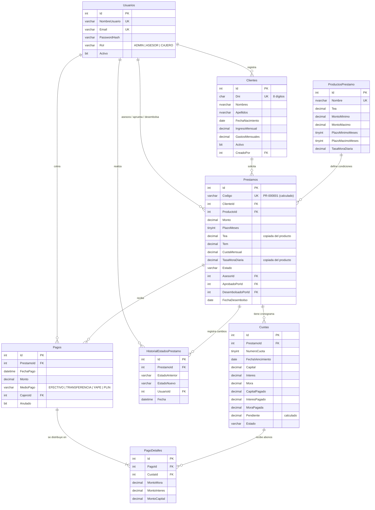

# PrestaFácil — Modelo de Datos

**Motor:** SQL Server · **Base de datos:** `PrestaFacilDB`
**Scripts:** [`database/`](../database)

---

## 1. Diagrama entidad-relación

---

## 2. Decisiones de diseño

| Decisión | Por qué |
|---|---|
| **`DECIMAL(12,2)` para montos**, nunca `FLOAT` | `FLOAT` tiene errores de redondeo (0.1 + 0.2 ≠ 0.3). En dinero eso no se acepta. |
| **TEM con `DECIMAL(12,10)`** | Con pocos decimales, el error se acumula cuota tras cuota y el saldo final no cierra en 0. |
| **La TEA y la mora se copian al préstamo** (RN-03) | Si el producto cambia de tasa, los préstamos antiguos mantienen las condiciones que firmó el cliente. |
| **La cuota guarda lo pagado por concepto** (`CapitalPagado`, `InteresPagado`, `MoraPagada`) | Permite pagos parciales y saber exactamente qué parte de la deuda se cubrió. |
| **Tabla `PagoDetalles`** | Un pago puede cubrir varias cuotas. El detalle muestra cómo se distribuyó (RN-09) y permite anular el pago revirtiendo cada abono. |
| **Columnas calculadas `PERSISTED`** (`Codigo`, `MontoCuota`, `Pendiente`) | El valor siempre es consistente y se puede indexar. |
| **`CHECK` constraints** | La base de datos rechaza datos inválidos (DNI con letras, estados inexistentes, pagos mayores a la deuda de la cuota) aunque falle la validación de la API. |
| **Sin borrado físico** (`Activo`, `Anulado`) | Trazabilidad para auditoría (RN-11). |
| **Historial de estados** | Responde quién aprobó, rechazó o desembolsó cada préstamo y cuándo (RN-12). |

---

## 3. Dónde vive cada regla

| Lógica | Dónde | Por qué |
|---|---|---|
| Cálculo de cuota y cronograma | API (C#) | Se prueba con xUnit y se reutiliza en el simulador (RF-07). |
| Evaluación de la solicitud (RN-04 a RN-07) | API (C#) | Reglas de negocio que cambian con frecuencia; deben tener pruebas. |
| Aplicación de pagos (RN-09) | API (C#), en una transacción | Lógica compleja que necesita pruebas; la transacción garantiza que todo se guarde o nada. |
| Proceso diario de mora | `sp_ActualizarCuotasVencidas` | Actualiza muchas filas a la vez; en SQL es una sola sentencia. |
| Reportes | `sp_ReporteCartera`, `sp_ReporteMorosos`, `sp_ReporteCobranza`, `sp_EstadoCuentaCliente` | Agregaciones sobre muchos registros; la base de datos lo resuelve mejor. |
| Integridad de datos | Constraints, `UNIQUE` y `FOREIGN KEY` | Última línea de defensa. |

---

## 4. Procedimientos almacenados

| Procedimiento | Parámetros | Devuelve |
|---|---|---|
| `sp_ActualizarCuotasVencidas` | `@FechaCorte` (opcional, por defecto hoy) | Cantidad de cuotas actualizadas |
| `sp_ReporteCartera` | — | Préstamos, monto y saldo de capital por estado |
| `sp_ReporteMorosos` | `@DiasMinimos`, `@FechaCorte` | Préstamos con cuotas vencidas, días de atraso y deuda |
| `sp_ReporteCobranza` | `@Desde`, `@Hasta` | Total cobrado por cajero y medio de pago, separado en capital, interés y mora |
| `sp_EstadoCuentaCliente` | `@ClienteId` | 2 resultados: resumen por préstamo y cuotas por pagar |

---

## 5. Datos de prueba

`03_seed.sql` carga 4 usuarios, 3 productos, 8 clientes y 8 préstamos. Los préstamos cubren todos los estados:

| Préstamo | Cliente | Escenario |
|---|---|---|
| PR-000001 | Ana Flores | Desembolsado, al día |
| PR-000002 | Jorge Ramírez | **En mora**: 2 cuotas vencidas |
| PR-000003 | Diana Paredes | Pagado por completo |
| PR-000004 | Pedro Huamán | 1 cuota vencida hace 10 días |
| PR-000005 | Valeria Chávez | Pendiente de aprobación |
| PR-000006 | Roberto Gonzales | Aprobado, falta desembolsar |
| PR-000007 | Silvia Torres | Rechazado por capacidad de pago (RN-04) |
| PR-000008 | Ana Flores | Su segundo préstamo activo: ya no puede pedir otro (RN-05) |

Las fechas se calculan a partir del día en que se ejecuta el script, así que siempre hay casos al día y casos en mora.
